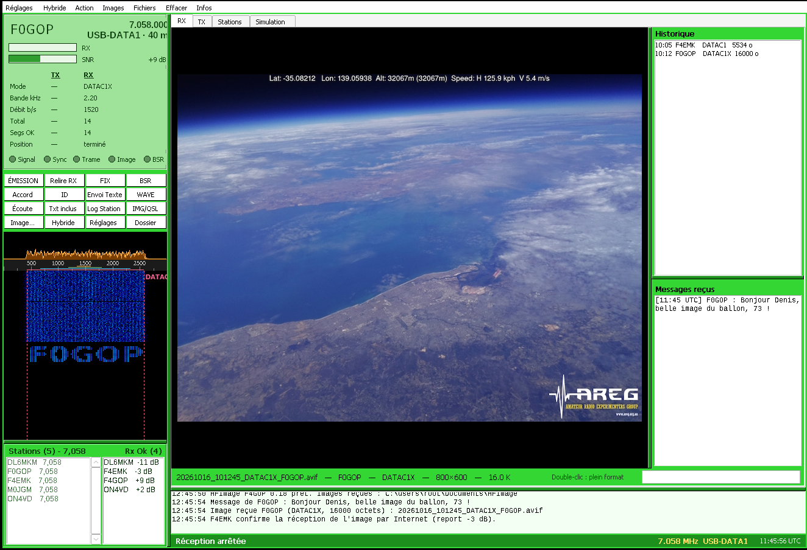
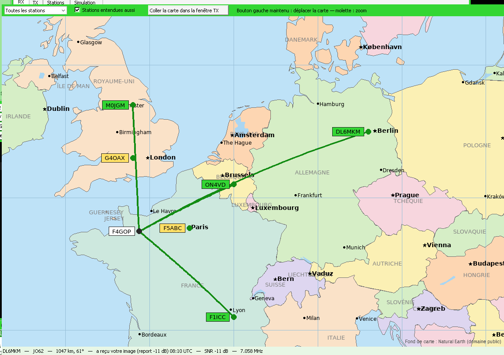
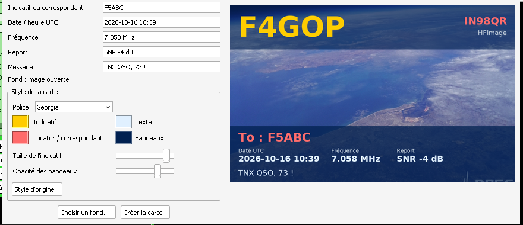
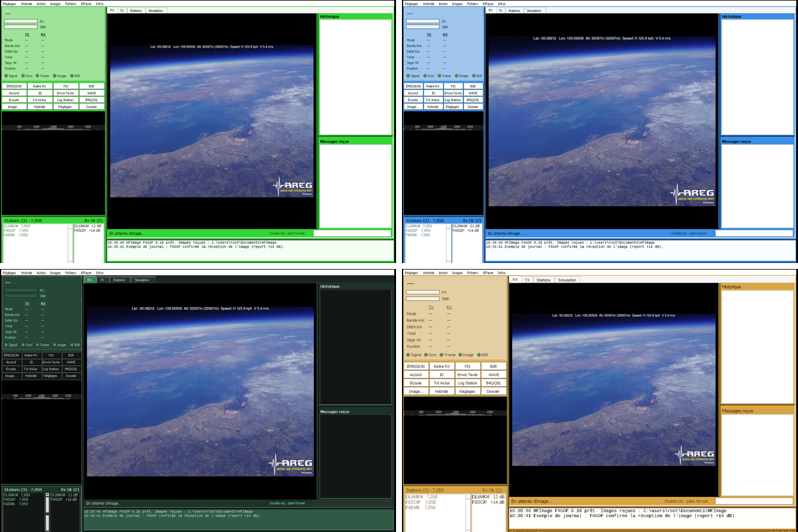
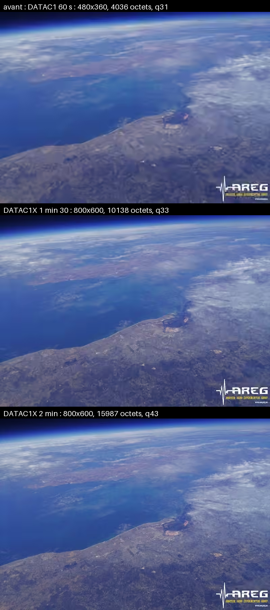
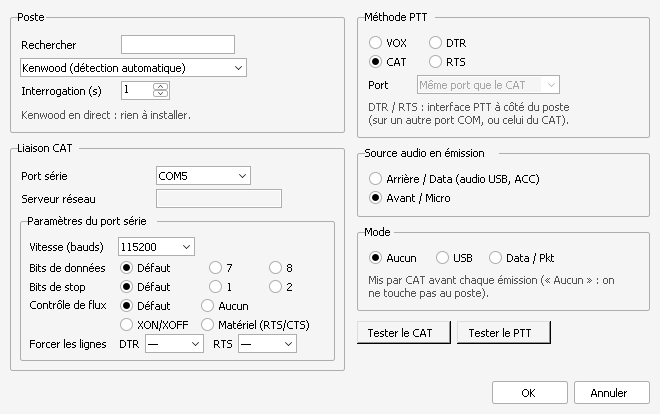
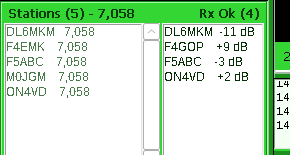
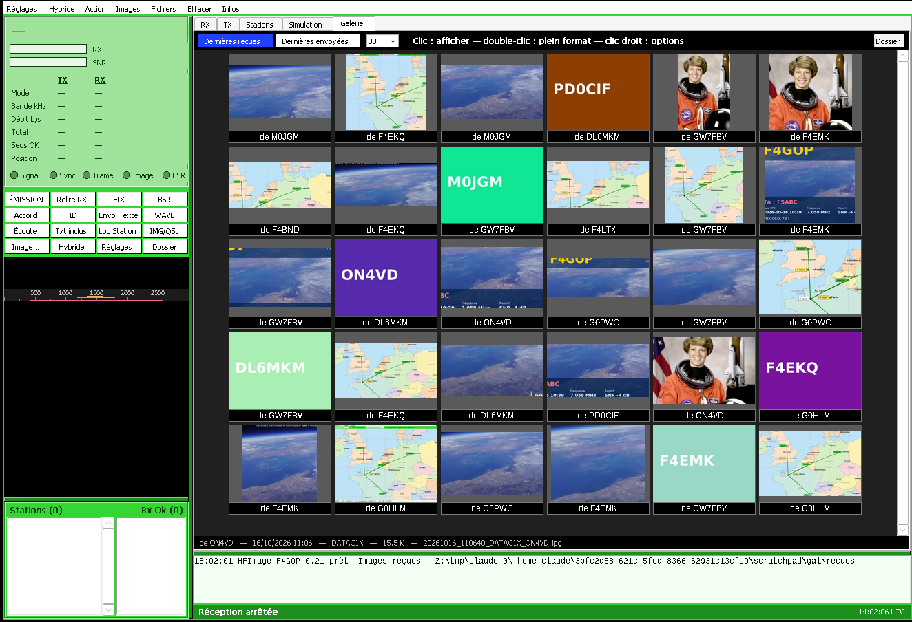

# HFImage F4GOP

**Transmission d'images numériques en HF, façon EasyPal — sans SSTV.**
Programme Windows de F4GOP (Denis, IN98QR) pour envoyer et recevoir des photos par radio, avec un modem numérique moderne (codec2 OFDM), une correction d'erreurs par code fontaine et un mode hybride par Internet.



## Téléchargement

👉 **[Dernière version : HFImage_F4GOP.exe](https://github.com/f4gopdenis-cyber/HFImage_F4GOP/releases/latest)**

- Un seul fichier, rien à installer (Windows 10 / 11, 64 bits).
- Au premier lancement, Windows SmartScreen peut afficher un avertissement : cliquez sur « Informations complémentaires », puis « Exécuter quand même ».
- Ensuite, le programme se met à jour tout seul : un bandeau apparaît quand une nouvelle version est publiée, un clic suffit.

## Ce que fait le programme

### Images
- Envoi de **photos nettes en 800×600 en environ 2 minutes** grâce au mode rapide **DATAC1X** (1 420 bit/s utiles, 2,2 kHz de large). Pour les conditions difficiles : DATAC1, DATAC3, DATAC4.
- **Mode Auto** : DATAC1X, DATAC1 ou DATAC3 choisi d'après les reports des stations ; **robustesse** réglable contre le QSB.
- L'image reçue est **identique bit à bit** à l'image envoyée, ou rien : pas d'image « abîmée ».
- Formats AVIF (le plus compact), WebP, JPG, ou le fichier **original** tel quel ; SVG vectoriel en quelques centaines d'octets.
- **Aperçu rapide** : une petite image arrive en ~20 s, puis l'image complète la remplace.
- **BSR / FIX** : une station à qui il manque des morceaux le demande, l'émetteur ne renvoie que ce qui manque.
- **Mode hybride** : l'image passe par votre hébergement web (FTP), seul le lien passe par radio (~11 s). Fonctionne aussi pour les **GIF animés**.

### Comme dans EasyPal
- Disposition familière : panneau d'état, grille de boutons, waterfall, onglets RX / TX.
- **Stations en ligne** : dès l'ouverture du programme, on voit toutes les stations qui ont HFImage ouvert, avec leur fréquence (présence par Internet).
- **Rx Ok** : la liste des stations qui ont reçu l'image, avec leur **report en dB**, visible par tout le monde.
- **Carte des stations** : votre station et celles qui ont reçu l'image, placées d'après leur locator.
- **Galerie** des dernières images reçues et envoyées, comme EZPix.
- **Texte dans le waterfall** (begin.wav / end.wav), envoi de texte, texte inclus avec l'image.
- **Carte QSL** : photo de fond, indicatif, locator, report rempli automatiquement, police et couleurs au choix.

### Station
- **Plus de 300 postes** reconnus (Icom, Yaesu, Kenwood, Elecraft, Xiegu, Flex…), réglés comme dans WSJT-X : Kenwood en direct, **Hamlib**, **OmniRig**, **FLRig**.
- PTT par CAT, DTR, RTS (y compris sur une interface à côté du poste, sur un autre port COM) ou VOX. Fréquence du poste affichée et notée.
- **Kenwood TS-890 / TS-990** : codec audio USB, PTT par CAT (audio arrière / data).
- 5 langues (français, English, Deutsch, Español, Italiano).
- Couleurs (dont un thème **Nuit**), police et zones de la fenêtre réglables.

| | |
|---|---|
|  |  |
| Carte des stations | Carte QSL personnalisable |
|  |  |
| Thèmes de couleurs | DATAC1 60 s (avant) / DATAC1X 1 min 30 / DATAC1X 2 min |
|  |  |
| Réglages du poste (comme WSJT-X) | Stations en ligne et Rx Ok |
|  | |
| Galerie des dernières images | |

## Démarrage rapide (Kenwood TS-890 / TS-990)

1. Poste en **USB-DATA**, source audio de DATA SEND = **USB Audio**, **DATA VOX sur OFF**.
2. Lancez `HFImage_F4GOP.exe`, ouvrez **Réglages** :
   - indicatif et locator ;
   - sortie « Haut-parleurs (USB Audio CODEC) [MME] », entrée « Microphone (USB Audio CODEC) [MME] » ;
   - **Poste radio…** : poste « Kenwood TS-890S » ou « TS-990S », port COM virtuel du poste, 115200 bauds, PTT **CAT**, source audio **Arrière / Data** (DATA SEND, poste en USB-DATA), ou **Avant / Micro** si votre poste est réglé pour émettre l'audio USB sans le mode DATA ;
   - autres postes : choisissez-les dans la liste (Hamlib, OmniRig ou FLRig), puis **Tester le CAT**.
3. **Vérifier le poste**, **Tester la sortie (1 kHz)**, puis **Tester le PTT**.
4. Onglet **TX** → *Ouvrir une image…* → **Émettre**. Réglez le niveau pour que l'ALC ne bouge pas.

Détails (réglages du poste, mode hybride, protocole, débits) : **[docs/TECHNIQUE.md](docs/TECHNIQUE.md)**.

## Important

- **Les deux stations doivent utiliser HFImage**, de préférence la même version. Le mode DATAC1X n'existe que dans HFImage.
- La liste des stations en ligne passe par un serveur MQTT public (`broker.hivemq.com`). Elle ne partage que l'indicatif, le locator, la fréquence et l'état émission / réception. On peut la désactiver dans les Réglages.
- Diagnostic : `HFImage_F4GOP.exe --selftest rapport.txt` (modems, carte, accès Internet, cartes son, ports COM).

## Lancer depuis les sources (Windows)

Python 3.12 (64 bits), puis dans le dossier `src` :

```
pip install -r ..\requirements.txt
python app.py
```

`libcodec2.dll` (fournie dans `src/`) contient le mode DATAC1X. Pour la recompiler : [codec2_patch/README.md](codec2_patch/README.md).

Fabriquer l'exécutable :

```
cd src
pyinstaller --noconfirm HFImage.spec
```

## Organisation du dépôt

| Dossier | Contenu |
|---|---|
| `src/` | Programme Python, `libcodec2.dll`, données de la carte (`carte.bin`), recette PyInstaller |
| `codec2_patch/` | Mode DATAC1X ajouté à codec2 (source et instructions de compilation) |
| `exemples/` | Enregistrement d'une émission DATAC1, carte QSL en SVG, GIF animé |
| `docs/` | Guide technique et captures d'écran |
| `CHANGELOG.md` | Historique des versions |
| `THIRD_PARTY.md` | Composants utilisés et leurs licences |

## Contact

F4GOP — Denis — f4gop.denis@gmail.com

73 !

---

*English: HFImage F4GOP is a Windows program for sending digital images over HF radio, EasyPal-style but based on codec2 OFDM data modes (including a faster custom mode, DATAC1X) with fountain-code error correction, BSR/FIX repair, a hybrid mode (image via FTP, link over the air), an online station list and Rx Ok reports over MQTT, a station map and QSL card maker. The interface is available in English (Settings → Language).*
